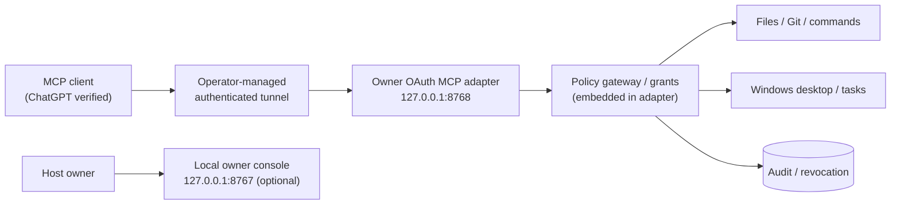

# WinOwner MCP

**Your Windows. Your AI. Your Control.**

Owner-authorized remote coding and desktop automation for Windows through the Model Context Protocol (MCP).

[](https://github.com/phuonghuster7/winowner-mcp/actions/workflows/ci-security.yml)
[](LICENSE)


[Tiếng Việt](README.vi.md) · [Installation](docs/INSTALLATION.md) · [Connect ChatGPT](docs/CONNECT_CHATGPT.md) · [Security](SECURITY.md) · [Releases](https://github.com/phuonghuster7/winowner-mcp/releases)

> **Security-sensitive prerelease.** An AI client can perform actions using the permissions of the Windows account running the agent. This is not a sandbox or an independently certified security product. Do not expose an unauthenticated MCP endpoint publicly.

## What WinOwner MCP does

- **Remote coding:** inspect repositories, read and patch files, run commands and tests, review Git changes.
- **Owner verification:** OAuth 2.1 / PKCE S256, capability grants and revocable authorizations.
- **Recoverable changes:** SHA-256 file preconditions, backup/rollback tooling and audit records.
- **Windows control:** desktop interaction and task management when deliberately authorized.
- **Security controls:** a read-only default profile, owner console and emergency stop.

OAuth alone is not a differentiator. WinOwner's focus is the combination of *owner authorization, scoped execution and auditable, recoverable changes*.

## Client compatibility

| Client | Status | Notes |
|---|---|---|
| ChatGPT | Verified on an owner's RC3 installation | Private tunnel and OAuth required |
| Claude, Cursor, Codex, other MCP clients | Not yet verified | Compatibility must be tested per client |

## Architecture



Other local gateway, bridge and backend services may be used by the full legacy stack. Their availability and ports depend on deployment; the standalone adapter does not automatically provision those services.

## One-line Windows setup — local read-only MCP

Paste this **single line into PowerShell** (Git required; Python 3.12 can be installed with winget when available):

```powershell
git clone https://github.com/phuonghuster7/winowner-mcp.git winowner-mcp; if ($LASTEXITCODE -eq 0) { powershell.exe -NoProfile -ExecutionPolicy Bypass -File ".\winowner-mcp\scripts\Bootstrap-WindowsMcp.ps1" }
```

The bootstrap configures read-only access, installs isolated Python dependencies and registers a **least-privilege Windows Task Scheduler job** that starts the local adapter automatically when the installing user logs in. It verifies health and rejects unauthenticated MCP calls. It does **not** enable OWNER_GLOBAL_FILESYSTEM, open firewall ports, configure a private tunnel or pair ChatGPT.

Use `powershell.exe -NoProfile -ExecutionPolicy Bypass -File .\scripts\Bootstrap-WindowsMcp.ps1 -DryRun` to check prerequisites without changes; use `-Remove` to stop the owned service and unregister its logon task (credentials intentionally retained for manual removal). Bootstrap is idempotent and refuses to kill processes it cannot verify as its own.

**LOCAL_INSTALL_PASS is not OAuth pairing.** The one-line bootstrap is part of the P0 changes in PR #9 and is **not included in the historic RC3 release ZIP**.

## Getting started on Windows 10/11

**Current published RC3:** Git and Python 3.12+ are required. Use a disposable Windows checkout:

```powershell
git clone https://github.com/phuonghuster7/winowner-mcp.git
cd winowner-mcp
py -3.12 -m venv .venv
.\.venv\Scripts\python.exe -m pip install -r requirements-dev.txt
powershell.exe -NoProfile -ExecutionPolicy Bypass -File .\scripts\Install-WindowsMcpAgent.ps1 -DryRun
```

The dry-run checks prerequisites; it **does not** enable remote access or connect a ChatGPT account. See [installation](docs/INSTALLATION.md) and [owner pairing](docs/CONNECT_CHATGPT.md).

**One-line local read-only bootstrap is being validated in [PR #9](https://github.com/phuonghuster7/winowner-mcp/pull/9)**; it is not yet part of the published RC3 release. Remote OAuth/tunnel pairing remains a separate owner-authorized step.

## Permission model

| Tier | Purpose | Default |
|---|---|---|
| READ | Search, inspect and read | Enabled in `read_only` |
| WRITE | Edit/create/delete files | Explicit authorization |
| EXECUTE | Run shell commands and tests | Explicit authorization |
| DESKTOP | Mouse, keyboard, windows | Explicit authorization |
| SYSTEM_ADMIN | Higher-impact administration | Denied by default |

`OWNER_GLOBAL_FILESYSTEM` is an **opt-in**, owner-only capability subject to the Windows service account's filesystem rights. It is not enabled in a standard installation. Text-pattern command blocking is an accident guard, **not a security boundary**.

## Testing and known limitations

- GitHub Actions covers source hygiene, history scanning, Ruff, selected security tests and installer dry-run.
- Some live authorization, physical desktop and rollback tests require a separately controlled Windows environment and are not yet covered by headless CI.
- A fresh Windows machine, end-to-end remote pairing and unattended restart need separate release acceptance. Do not present RC3 as production-ready.

See [Troubleshooting](docs/TROUBLESHOOTING.md), [Contributing](CONTRIBUTING.md), [Changelog](CHANGELOG.md) and [Security](SECURITY.md).

## License and trademarks

MIT license — [LICENSE](LICENSE). WinOwner MCP is independent and is not affiliated with or endorsed by Microsoft or OpenAI. Windows and ChatGPT are trademarks of their respective owners.
